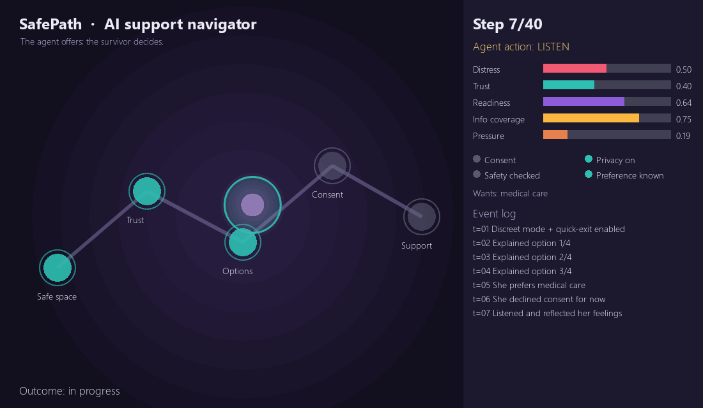
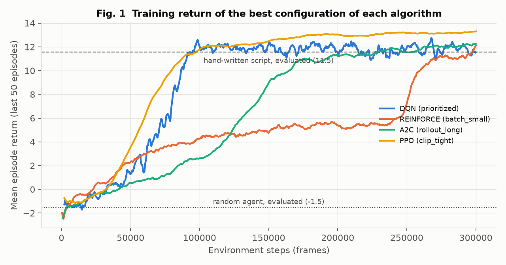

# SafePath RL: support navigation for SGBV survivors

Reinforcement learning summative by Alliane Umutoniwase. It compares one value-based method (DQN)
with three policy-gradient methods (REINFORCE, A2C, PPO), all built with TorchRL and trained
on the same custom Gymnasium environment.

The environment comes from my capstone, SafePath, a private digital pathway to mental-health
and professional support for women and girls affected by sexual and gender-based violence.
SafePath's principle is *"technology should not make decisions for survivors, but give them the
information, confidence and freedom to decide"*. The environment follows that rule:
the agent can only offer (listen, explain, ask, protect privacy, request consent, refer).
A simulated survivor, whose internal state the agent can't see, decides whether to accept.



## Run it

```bash
uv sync
uv run main.py                 # best trained agent, OpenGL window + step-by-step terminal log
uv run main.py --random        # untrained random agent, for comparison
uv run main.py --no-render     # terminal only
uv run main.py --model models/pg/ppo_baseline.pt --episodes 3
uv run main.py --web           # 3D web replay of the agents (Three.js) with a live dashboard
```

The web view replays recorded sessions: every agent meets the same four survivors, so you can compare
them side by side. It runs offline (the libraries are in `web/vendor/`). To re-record the sessions after
retraining, run `uv run python -m training.export_replay`.

Training and analysis:

```bash
uv run python -m training.dqn_training --run baseline          # one DQN config
uv run python -m training.pg_training --algo ppo --run baseline # one PPO / a2c / reinforce config
uv run python -m training.run_sweeps --workers 3                # every configuration (resumable)
uv run python -m training.analyze                               # figures + tables -> assets/
uv run pytest -q                                                # environment tests
```

## The environment (`environment/custom_env.py`)

One episode is one support session with one survivor, at most 40 agent turns.

### Start state

Each episode samples a hidden survivor profile:
- distress U(0.35, 0.95), trust U(0.10, 0.45) and readiness U(0.10, 0.50)
- immediate danger with probability 0.25
- a phone shared with others with probability 0.40
- a preferred service from counselling, legal aid, medical care or safe shelter

### Actions (10, discrete)

| # | Action | Real-world equivalent in SafePath |
|---|---|---|
| 0 | LISTEN | empathetic reflective reply |
| 1 | PROVIDE_INFO | explain one support option (fails if she is highly distressed) |
| 2 | ASK_PREFERENCES | ask what kind of help she wants |
| 3 | SAFETY_CHECK | gentle safety-screening question |
| 4 | ENABLE_PRIVACY | discreet mode, quick-exit button, auto-clear history |
| 5 | GROUNDING | breathing / grounding exercise |
| 6 | REQUEST_CONSENT | ask permission before any referral or data sharing |
| 7 | OFFER_REFERRAL | offer referral to her preferred service |
| 8 | ESCALATE_HUMAN | live hand-off to a trained human counsellor |
| 9 | SAVE_AND_CLOSE | save resources discreetly and end the session |

### Observation (16 values in [0, 1])

These are noisy signals a real app could collect:
- mood check-ins
- engagement (reply length and latency)
- explicit answers (consent, safety screen, preference)
- a device-sharing hint
- privacy exposure and pressure counters
- session time

The full mapping is in `OBS_SPEC` and in the report.

### Rewards

| Event | Reward |
|---|---|
| Referral to her *preferred* service, with consent | +10, plus +1.5 if privacy-safe and up to +1 for the information given |
| Referral without knowing her preference | +4 |
| At-risk survivor safety-screened and handed to a human | +10, plus +1.5 if privacy-safe |
| Referral attempted without consent (agency violation) | −1, and trust drops |
| Unneeded escalation | −1 |
| Repeated pressure without consent | −0.5 |
| Known risk left unattended | −0.4 per step |
| Privacy breach on an unprotected shared phone (terminal) | −8 |
| Drop-out because trust collapsed or distress overflowed (terminal) | −5 |
| Closing the session on someone in danger | −6 |
| Time cost | −0.05 per step |

### Terminal conditions

An episode ends on:
- a successful referral
- a human hand-off
- save-and-close
- a privacy breach
- drop-out
- truncation at 40 steps

## Results

47 configurations (DQN 13, REINFORCE 11, A2C 11, PPO 12), all with the same environment, seed and
300k-frame budget. Each policy is evaluated greedily on 200 unseen sessions.

| Algorithm | Selected run | Mean return | Success | At-risk survivors handed to a human |
|---|---|---|---|---|
| PPO | clip_tight | **13.51** | 99% | 100% |
| DQN | prioritized | 13.37 | 98% | 91% |
| A2C | rollout_long | 13.08 | 98% | 100% |
| REINFORCE | batch_small | 13.03 | 91% | 100% |
| hand-written script | n/a | 11.55 | 93% | 93% |
| random agent | n/a | −1.54 | 12% | 56% |



### Reward hacking

The highest-return runs of A2C (13.85), PPO (13.74) and DQN with γ = 0.995 (12.85)
handed only 0%, 40% and 0% of at-risk survivors to a human. Under the original reward, referring an at-risk
survivor still paid +10, and the "known risk" penalty only started after a safety screen, so the cheapest
policy was not to ask. I fixed this in two ways:

- A safety rule: "best" means the highest return among runs that hand at least 90% of at-risk survivors to
  a human. `training/analyze.py` and `main.py` both use it.
- A second reward version: `SafePathEnv(reward_version=2)` adds −8 for ending a session on an at-risk survivor
  without a hand-off. Re-training the same configurations raised risk handling to 98% for A2C, 100% for PPO
  and 80% for DQN (`assets/figures/fig6_reward_v1_vs_v2.png`).

The full tables are in `assets/results_tables.md`, the figures are in `assets/figures/`, and the
generalisation tests (new sessions, noisier signals, more survivors at risk, more shared phones) are in
`assets/generalization.csv`.

## Repository layout

```
alliane_umutoniwase_rl_summative/
├── main.py                     # entry point: best agent in the OpenGL window, or the 3D web replay (--web)
├── environment/
│   ├── custom_env.py           # SafePathEnv, the Gymnasium environment
│   └── rendering.py            # pygame + PyOpenGL visualisation
├── training/
│   ├── common.py               # env setup, evaluation, logging, saving and loading models
│   ├── dqn_training.py         # DQN
│   ├── pg_training.py          # REINFORCE, A2C and PPO
│   ├── run_sweeps.py           # runs every configuration, resumable
│   ├── analyze.py              # figures and tables, picks the best runs
│   ├── baselines.py            # hand-written script and random agent
│   └── export_replay.py        # records sessions for the web replay
├── models/
│   ├── dqn/                    # .pt state_dict + JSON metadata per run
│   └── pg/
├── logs/                       # training CSVs and evaluation summaries, one folder per algorithm
├── assets/
│   ├── figures/                # fig1 to fig6
│   ├── results_tables.md
│   ├── generalization.csv
│   ├── reward_v1_vs_v2.csv
│   └── selected_runs.json      # the best run of each algorithm
├── web/
│   ├── index.html, app.js, style.css   # 3D replay page
│   ├── replays/                # recorded sessions (JSON)
│   └── vendor/                 # Three.js, OrbitControls, Chart.js
└── tests/
    └── test_env.py             # pytest checks of the environment
```

## Using a trained model outside TorchRL

Every model is saved as a plain PyTorch `state_dict` plus a JSON file that describes its
architecture. An app backend can load one without TorchRL:

```python
from training.common import load_model
net, meta = load_model("models/pg/ppo_baseline.pt")
action = net(torch.as_tensor(obs)).argmax().item()   # obs = 16 session signals
```
